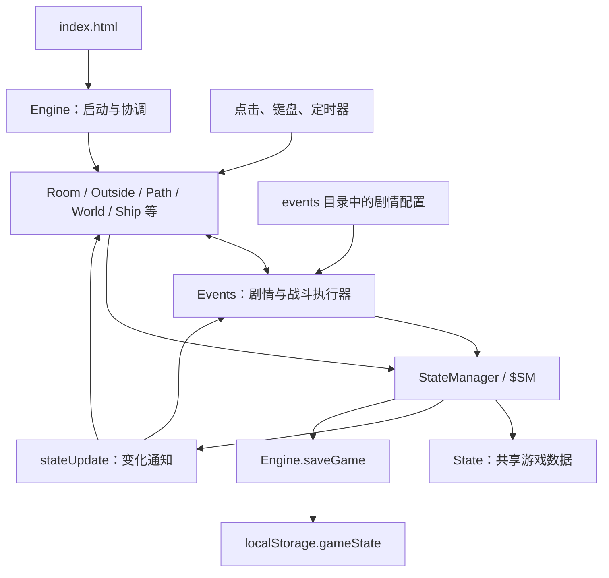

# A Dark Room：给初学者的项目架构与源码阅读指南

本文面向没有开发经验、尚未学习 JavaScript 的读者。目标是让你知道游戏由哪些部分组成、文件之间怎样协作，以及如何从一个小功能开始读懂代码。不需要先看懂每一行。

依据：2026-09-12 初稿，2026-10-04 按本地扩展版维护。当前进度、验证结果和限制见 [项目当前状态](project-status.md)。涉及后期模块名称，但不展开结局剧情。文中的文件链接均相对于本文件，可以在支持 Markdown 的编辑器中点击。

## 1. 先理解：一个网页游戏由什么组成

这个项目的核心是一个运行在浏览器中的单机游戏。浏览器加载文件后，负责显示界面、执行规则、产生随机事件和保存进度。

| 名词 | 在这个项目中的含义 | 例子 |
|---|---|---|
| HTML | 定义页面最初的结构，以及要加载哪些文件 | `index.html` |
| CSS | 决定颜色、字号、间距、位置和部分视觉效果 | `css/main.css` |
| JavaScript，简称 JS | 执行游戏规则，响应点击，修改界面和数据 | `script/room.js` |
| DOM | 浏览器内存中的页面元素树；JS 可以修改它 | 库存中的一行、一个按钮 |
| jQuery | 简化查找元素、绑定点击和修改页面的 JS 工具库 | `$('#header')` 查找页头 |
| 状态 State | 当前这一局游戏的数据 | 木材数量、人口、地图、解锁标记 |
| localStorage | 浏览器按站点保存少量文本数据的空间 | 游戏存档 |
| Node.js | 在浏览器外执行 JS 的运行环境 | 启动本地开发服务器 |
| npm | 随 Node.js 使用的包管理和命令运行工具 | 安装 Express，执行启动命令 |
| Git | 记录文件修改历史的工具 | 查看改动、保存一个版本 |
| GitHub | 托管 Git 仓库的网站 | 你 fork 的项目副本 |

这里没有负责结算战斗的远程服务器，也没有游戏数据库。`dev-server.js` 只是把本地文件通过 HTTP 提供给浏览器。关闭它不会把游戏逻辑转移到服务器；逻辑始终在浏览器执行。

可以先把整个项目理解为：**入口加载文件 → 各模块创建界面 → 玩家操作或定时器触发规则 → 修改游戏状态 → 刷新界面并保存。**

## 2. 目录总览

```text
adarkroom/
├── index.html              网页入口
├── dev-server.js           本地静态文件服务器
├── package.json            项目信息、依赖、启动命令
├── yarn.lock               Yarn 的依赖版本锁定文件
├── README.md               原项目介绍
├── contributing.md         贡献代码的说明
├── LICENSE.md              许可证原文
├── browserWarning.html     浏览器不满足检查条件时的提示页
├── mobileWarning.html      移动设备提示页
├── favicon.ico             浏览器标签页图标
├── script/                 游戏逻辑与界面控制
│   └── events/             剧情、遭遇和地点事件配置
├── css/                    页面样式
├── lang/                   多语言翻译和语言专用样式
├── lib/                    工具库、第三方代码
├── audio/                  声音与音乐资源
├── img/                    图片资源
├── tools/                  开发辅助工具
├── doc/                    设计、翻译与学习文档
├── .git/                   Git 自己管理的历史数据
├── .gitignore              不纳入 Git 的文件规则
├── .gitattributes          文本、二进制等文件属性规则
└── .jshintrc               JSHint 代码检查配置
```

初学时主要看 `script/`、`css/`、`index.html`。翻译、音乐和第三方库可以先按需查看，不要从压缩后的 `jquery.min.js` 开始阅读。

### 根目录文件分别有什么用

| 文件 | 作用与阅读重点 |
|---|---|
| [index.html](../index.html) | 加载 jQuery、翻译、游戏脚本和 CSS；提供初始页面容器。大量实际界面会由 JS 动态生成，因此这里看不到全部按钮。还包含外部统计脚本。 |
| [dev-server.js](../dev-server.js) | 创建 Express 服务，将当前目录作为静态文件目录，监听 8080 端口。没有账户、战斗或存档 API。 |
| [package.json](../package.json) | `start` 对应 `node dev-server.js`；依赖中有 Express；`update_pot` 用于提取翻译文本。已有 `npm test`（逻辑与内容校验）和 `npm run test:browser`（真实浏览器回归）。 |
| [yarn.lock](../yarn.lock) | 记录 Yarn 解析出的依赖版本，通常交给包管理工具维护。 |
| [README.md](../README.md) | 游戏简介、语言入口和相关链接，不是完整的开发教程。 |
| [contributing.md](../contributing.md) | 原作者对贡献方式和代码检查的说明。部分说明体现了项目早期的工具习惯。 |
| [LICENSE.md](../LICENSE.md) | 使用、修改和分发代码时参考的许可证原文。 |
| [browserWarning.html](../browserWarning.html) | 浏览器能力检查不通过时显示的页面。 |
| [mobileWarning.html](../mobileWarning.html) | 保留的历史移动设备提示页；当前手机浏览器直接使用响应式游戏界面，不再自动跳转到此页。 |
| [.gitignore](../.gitignore) | 忽略 `node_modules`、编辑器临时文件等；不是删除这些文件。 |
| [.gitattributes](../.gitattributes) | 配置换行处理、二进制文件，以及 GitHub 的语言统计归类。 |
| [.jshintrc](../.jshintrc) | JSHint 的少量检查选项，不代表已经配置了自动测试流水线。 |

注意：`package.json` 中的 `"type": "module"` 适用于 Node.js 对相关 `.js` 文件的解释。浏览器中的游戏脚本仍通过普通 `<script>` 加载，并没有统一采用 `import` / `export`。

## 3. 整体架构：谁负责什么



如果编辑器不显示上图，看文字就够了：`Engine` 组织启动；玩法模块执行规则；`StateManager` 管理共享数据；状态变化通知相关模块更新；`Events` 根据剧情配置推进故事或战斗；`Engine` 把数据保存到浏览器。

这里的“模块”主要是按文件组织的全局对象，例如 `Room`、`World`。其他脚本可以直接调用它们的方法。这种结构容易跟踪，但依赖关系多半隐含在代码中，也依赖脚本加载顺序。

模块并没有严格拆成“数据文件、规则文件、显示文件”。例如 `room.js` 同时包含制作配方、扣资源的规则和创建按钮的代码。读一个函数时，要留意它是在读取数据、修改数据，还是修改页面。

## 4. 所有游戏脚本的职责

### 4.1 应用基础设施

| 文件 | 主要对象 | 作用 | 第一次阅读时找什么 |
|---|---|---|---|
| [engine.js](../script/engine.js) | `Engine` | 启动、加载和保存、菜单、地点切换、输入分发、定时器封装、技能描述；文件末尾还定义消息发布订阅工具。 | `init`、`saveGame`、`loadGame`、`travelTo`、`$.Dispatch` |
| [state_manager.js](../script/state_manager.js) | `StateManager`、`$SM` | 读写状态、批量修改、资源上下限、变化通知、旧存档迁移；还包含生产结算和技能等业务辅助逻辑。 | `get`、`set`、`add`、`addM`、`fireUpdate`、`collectIncome` |
| [Button.js](../script/Button.js) | `Button` | 创建可点击按钮，处理禁用、冷却、剩余冷却保存及成本提示。注意文件名首字母大写。 | `Button`、`cooldown`、`setDisabled` |
| [header.js](../script/header.js) | `Header` | 创建页头地点按钮；点击后请求 `Engine.travelTo` 切换地点。 | `addLocation` |
| [notifications.js](../script/notifications.js) | `Notifications` | 显示叙事和操作提示；非当前地点的消息可排队，抵达后显示。 | `notify`、`printMessage`、`printQueue` |
| [audio.js](../script/audio.js) | `AudioEngine` | 使用 Web Audio 加载、缓存、播放音乐和音效，控制音量与淡入淡出。 | `init`、`loadAudioFile`、`playSound` |
| [audioLibrary.js](../script/audioLibrary.js) | `AudioLibrary` | 把声音名称映射到资源文件，供玩法模块引用。 | 找一个熟悉的操作，如 `GATHER_WOOD` |
| [localization.js](../script/localization.js) | 文本集合 | 补充供翻译工具提取的字符串；实际翻译函数在 `lib/translate.js`。 | 文件开头的说明 |
| [dropbox.js](../script/dropbox.js) | Dropbox 连接器 | 历史上的可选云存档连接代码。当前 `index.html` 没有加载它，默认启动也没有启用它；不能据此认为当前云存档可直接使用。 | 初学时可跳过 |

### 4.2 玩法模块

| 文件 | 对象 | 职责与主要数据 |
|---|---|---|
| [room.js](../script/room.js) | `Room` | 房间、生火、温度、建造者进度、初期解锁、制作与交易，以及共享库存的显示。`Craftables` 是制作定义，`TradeGoods` 是交易定义。 |
| [outside.js](../script/outside.js) | `Outside` | 收集木材、检查陷阱、村庄人口、工人分配、生产来源。`_INCOME` 定义工种消耗和产出。 |
| [path.js](../script/path.js) | `Path` | 出发前选择补给和武器，计算负重，展示角色能力。`Weight` 定义部分物品重量，未列出的默认重量为 1。 |
| [world.js](../script/world.js) | `World` | 地图生成、揭雾、移动、地标触发、随机遇敌检查、食水消耗、回家和死亡；也集中定义武器参数及部分角色属性计算。 |
| [events.js](../script/events.js) | `Events` | 解释剧情场景、生成选项、处理成本和奖励、场景跳转、战斗、敌人行动与战利品。它是执行器，不只是随机事件列表。 |
| [fabricator.js](../script/fabricator.js) | `Fabricator` | 后期制造器、蓝图展示、制造条件和配方。 |
| [ship.js](../script/ship.js) | `Ship` | 飞船界面、船体与推进器升级、起飞确认和进入太空阶段。 |
| [space.js](../script/space.js) | `Space` | 飞船移动、障碍物、碰撞、起飞失败、成功离开、结局和结算展示。 |
| [prestige.js](../script/prestige.js) | `Prestige` | 定义可继承物资、随机保留比例、下一周目领取，以及保存累计分数。 |
| [scoring.js](../script/scoring.js) | `Score` | 按库存、舰队信标和最大船体等计算本局分数，并与历史累计分数相加。 |

`Room` 不仅负责“房间里看到的东西”：库存面板也由它维护。`World` 不只负责地图：武器和角色属性也在里面。这是当前项目的实际组织方式，文件名并不是完全严格的边界。

### 4.3 剧情与遭遇配置

| 文件 | 内容 | 由谁执行 |
|---|---|---|
| [events/global.js](../script/events/global.js) | 如抓获小偷等事件；是否可触发仍由各事件自己的条件决定，“global”不等于任何地方都发生。 | `Events` |
| [events/room.js](../script/events/room.js) | 房间中的访客、商人、侦察员、大师等事件。 | `Events` |
| [events/outside.js](../script/events/outside.js) | 村庄与室外的随机事件。 | `Events` |
| [events/encounters.js](../script/events/encounters.js) | 荒野随机战斗的敌人及遭遇条件。 | `World` 请求，`Events` 执行 |
| [events/setpieces.js](../script/events/setpieces.js) | 洞穴、城市、矿场、沼泽、飞船等地图地点的多场景内容。 | `World` 根据地标选择，`Events` 执行 |
| [events/executioner.js](../script/events/executioner.js) | 残破战舰的区域、敌人、蓝图和首领剧情。 | `World` 的战舰分支与 `Events` |
| [events/industry.js](../script/events/industry.js) | 三处工业遗址的战斗、发现与奖励。 | `World` 与 `Events` |
| [events/ships.js](../script/events/ships.js) | 侦察舰、运输舰与晶格碎片路线。 | `World` 与 `Events` |
| [events/frontier.js](../script/events/frontier.js) | 仓库、军事要塞及外圈遭遇。 | `World` 与 `Events` |
| [events/marketing.js](../script/events/marketing.js) | 其他作品的推广事件。与主线剧情机制共用执行器。 | `Events` |

这些文件不是纯粹的文字素材：它们包含 JS 对象、条件函数和回调，可以改变游戏状态。相同的事件框架也被用来显示导入导出、确认和设置等交互。

## 5. CSS、资源与辅助文件

### CSS 文件

| 文件 | 作用 |
|---|---|
| [css/main.css](../css/main.css) | 全局布局、主容器、按钮、菜单、提示、事件窗口等共享样式。 |
| [css/dark.css](../css/dark.css) | 关灯模式的颜色覆盖；由相应功能加载。 |
| [css/room.css](../css/room.css) | 房间、制作与库存相关布局。 |
| [css/outside.css](../css/outside.css) | 村庄、工人等室外界面样式。 |
| [css/path.css](../css/path.css) | 出行准备、装备和负重界面样式。 |
| [css/world.css](../css/world.css) | 字符地图、地标提示、探险补给面板样式。 |
| [css/fabricator.css](../css/fabricator.css) | 制造器和蓝图界面样式。 |
| [css/ship.css](../css/ship.css) | 飞船升级界面样式。 |
| [css/mobile.css](../css/mobile.css) | 手机布局、触摸控件和弹窗；行为由 `script/mobile.js` 配合。 |
| [css/space.css](../css/space.css) | 太空阶段、飞船及相关显示效果。 |

修改 CSS 通常改变外观，不会直接改变木材数量或武器伤害。布局也有由 JS 设置的部分，因此有些位置和动画要同时查看脚本。

### 翻译、工具库和媒体

| 文件或目录 | 作用 |
|---|---|
| `lang/langs.js` | 可选语言及显示名称。 |
| `lang/<语言>/strings.po` | 面向翻译人员的文本目录，例如 `lang/zh_cn/strings.po`。 |
| `lang/<语言>/strings.js` | 浏览器实际加载的翻译数据。 |
| `lang/<语言>/main.css` | 对应语言的样式调整。 |
| `lang/adarkroom.pot`、`lang/babel.cfg` | 翻译模板与文本提取配置。各语言目录有同类文件，不需要逐个阅读。 |
| `lib/jquery.min.js` | 本地 jQuery 副本；入口先尝试 CDN，失败时使用本地文件。 |
| `lib/jquery.color-2.1.2.min.js` | 颜色动画支持。 |
| `lib/jquery.event.move.js`、`lib/jquery.event.swipe.js` | 移动和滑动手势支持。 |
| `lib/base64.js` | 存档导入导出使用的 Base64 编解码工具。Base64 是编码，不是加密。 |
| `lib/translate.js` | 提供 `_()` 翻译函数和文本参数替换。 |
| `lib/icu.js` | 日期、数字等本地化格式辅助代码；当前入口没有直接加载，初学时可跳过。 |
| `audio/` | 音乐和音效文件；名称映射见 `audioLibrary.js`。 |
| `img/` | 游戏标识、分享图片、浏览器提示图片等；地图主要是字符，并不依靠地形图片。 |
| [tools/po2js.py](../tools/po2js.py) | 用 Python 把 `.po` 翻译文件转换为 JS，使用 `polib`。 |
| `doc/Events.xlsx` | 事件相关表格资料，游戏运行时不加载；本文未逐格审阅。 |
| [doc/Zones.txt](Zones.txt) | 区域与战斗数值的简短设计参考，不应当作当前所有数值的权威来源。 |
| [doc/translation.txt](translation.txt) | 翻译流程说明；部分工具操作可能属于较早时期。 |
| 本文 | 源码学习指南，不参与游戏运行。 |

## 6. 游戏是怎样启动的

入口流程可以按以下顺序读：

1. 浏览器打开 `index.html`，读取 HTML、CSS 和脚本。
2. 入口优先从 URL 的 `lang` 参数选择语言，没有时尝试读取已保存语言；按需加载语言文件。
3. 游戏脚本执行，定义 `Engine`、`Room` 等对象。此时“定义好了函数”不等于“已经调用函数”。
4. `engine.js` 末尾的 `$(function() { Engine.init(); });` 注册页面就绪后的启动操作。
5. `Engine.init()` 检查浏览器和设备，读取存档，创建菜单与容器，绑定键盘和滑动操作。
6. 初始化状态管理、声音、消息、事件和房间。根据已有资源与解锁状态，初始化室外、道路、制造器、飞船等模块。
7. `Engine.travelTo(Room)` 将当前地点设为房间，之后进入等待玩家操作和定时任务的阶段。

脚本顺序很重要：事件配置会引用已经定义的 `Events`、`World` 等名称。准备新增文件时，除了创建文件，还要确认 `index.html` 加载了它，并且加载位置合适。

## 7. 状态、规则和界面：三个最重要的概念

可以用下面的简化对象理解 `State`。这只是示意，不是完整存档，也不要复制进去覆盖真实存档。

```javascript
const exampleState = {
  stores: { wood: 10, fur: 2 },
  features: { location: { world: true } },
  character: { perks: { scout: true } },
  game: { population: 4 },
  outfit: { 'cured meat': 5 },
  config: { soundOn: false }
};
```

`stores`、`features` 叫对象的属性。`exampleState.stores.wood` 表示先找 `stores`，再找其中的 `wood`。对象可以层层嵌套，所以游戏能把不同类别的数据放在同一棵结构中。

| 状态类别 | 大致内容 |
|---|---|
| `stores` | 仓库物资和物品 |
| `features` | 已解锁功能和地点 |
| `game` | 火焰、村庄、工人、建筑、世界地图、飞船等 |
| `character` | 技能、训练计数、蓝图等 |
| `income` | 各生产来源的周期、倒计时、消耗和产出 |
| `outfit` | 探险补给与装备相关数据 |
| `previous` | 跨周目累计分数和待领取物资 |
| `config` | 声音、显示、加速等设置 |
| `playStats` | 部分游戏统计和提示标记 |
| `timers`、`wait`、`cooldown` | 计时、延迟事件和按钮冷却相关数据 |

这不是严格的数据模式；代码还能增加别的分支。也不是所有运行信息都在 `State` 中：当前 DOM 元素、计时器句柄、部分战斗状态保存在模块对象或页面元素上。

### 用 `$SM` 读写数据

```javascript
$SM.get('stores.wood');                  // 读取木材
$SM.get('stores.wood', true);            // 对不存在等情况按其规则返回 0
$SM.set('stores.wood', 100);             // 设为 100
$SM.add('stores.wood', 10);              // 在当前数量上增加 10
$SM.addM('stores', { wood: -5, fur: 2 }); // 一次修改多种物资
```

上面展示的是 API 用法。`set`、`add` 等会真的改变存档，学习时先使用 `get` 观察，修改前导出自己的存档。

普通修改会触发保存和 `stateUpdate` 通知。通知带有发生变化的类别和路径，例如 `stores`、`stores.wood`。模块订阅通知后，用 `handleStateUpdates` 判断是否需要刷新。

批量操作内部可以暂时不通知，最后统一保存和广播。源码中常见的 `noEvent` 参数与此有关。直接写 `State.stores.wood = 100` 会绕过这条正常流程，可能导致页面暂时不更新；初学时优先通过 `$SM` 操作。

还要注意：目前 `$SM.get()` 可能返回原对象的引用，不是独立副本；修改返回对象可能直接修改原状态。它也使用 `eval` 处理路径，这是读旧代码需要知道的实现细节，不建议把这种写法当作新项目的默认范式。

## 8. 跟踪实例一：点击“收集木材”之后发生了什么

最适合作为第一次阅读练习的是 `Outside.gatherWood()`：

```javascript
gatherWood: function() {
  Notifications.notify(Outside, _("dry brush and dead branches litter the forest floor"));
  var gatherAmt = $SM.get('game.buildings["cart"]', true) > 0 ? 50 : 10;
  $SM.add('stores.wood', gatherAmt);
  AudioEngine.playSound(AudioLibrary.GATHER_WOOD);
}
```

逐句理解：第一句显示经过翻译的消息；第二句检查有没有推车，有则采集 50，没有则采集 10；第三句增加仓库木材；最后一句播放音效。

这里的 `条件 ? 值甲 : 值乙` 叫条件表达式：条件成立选甲，否则选乙。`function() { ... }` 定义一个函数，函数被调用时才执行括号里的操作。

完整调用关系是：按钮收到点击 → 按钮处理冷却 → 调用 `Outside.gatherWood` → `$SM.add` 更新木材 → 保存并广播状态变化 → `Room` 刷新库存和建造按钮，`Outside` 刷新相关村庄显示。如果此时存在事件窗口，事件系统也可能更新选项是否可用。

注意这里的“消息”有两种：`Notifications` 给玩家看叙事文字，`stateUpdate` 给程序模块传递变化通知。它们不是同一个系统。

## 9. 跟踪实例二：剧情选项是怎样工作的

下面是一个为讲解而简化的事件结构，不是已加入项目的新事件：

```javascript
const exampleEvent = {
  title: _('An Old Cache'),
  isAvailable: function() {
    return Engine.activeModule == Room;
  },
  scenes: {
    start: {
      text: [_('a wooden box lies in the corner.')],
      buttons: {
        open: {
          text: _('open'),
          nextScene: { 1: 'found' }
        },
        leave: {
          text: _('leave'),
          nextScene: 'end'
        }
      }
    },
    found: {
      text: [_('some dry wood remains inside.')],
      reward: { wood: 10 },
      buttons: {
        done: { text: _('leave'), nextScene: 'end' }
      }
    }
  }
};
```

`title` 是标题，`isAvailable` 决定事件是否符合发生条件，`scenes` 收集场景，`start` 是起点，`buttons` 描述选择。`nextScene` 指向下一场景；`{ 1: 'found' }` 表示该选择确定进入 `found`。更复杂的对象可用概率阈值分配分支，不应简单把所有键当成互不相关的概率。

`Events` 负责读取这些配置并创建界面。场景带有 `reward` 时执行奖励；带有 `combat` 时进入战斗；带有 `onLoad` 时在载入场景时运行回调。按钮还可以包含成本、奖励和选择后的操作。

新增事件需要把对象加入对应事件集合；若采用独立文件，还需要将文件接入入口和事件池。仅创建一个没有被引用的对象不会让事件自动发生。

## 10. 探索地图与战斗如何衔接

新地图边长为 `2 * World.RADIUS + 1`，默认半径45，因此是91×91，共8281格。逻辑坐标为−45…45，村庄在 `[0,0]`；数组中心索引为 `[45,45]`，由 `toIndex`／`toCoord` 转换。旧地图按存档半径或数组尺寸加载，通常仍为61×61。地图采用 `map[x][y]` 的索引形式，阅读二维数组时不要默认第一维就是行。

`generateMap` 先生成普通地形，再根据 `LANDMARKS` 放置地点；新地图从合法格子中抽样，初始地标间至少相距3格，多数量类型按象限分配。`mask` 记录哪些格子已揭开。显示窗口从10×10随探索扩大，最大91×91；`drawMap` 复用网格节点，仅更新变化的格子，窗口尺寸或容器变化时才重建。当前地点参数见 [地标参数](world-landmark-settings.md)。

一次移动的大致过程是：修改坐标 → 更新描述与可见区域 → 重画地图 → 检查当前位置。到村庄就回家；到地标就进入对应事件；普通行路分支处理食水消耗，并可能触发随机战斗。

`Path` 负责出发准备；出发时从仓库扣除携带物资。`World` 负责探险过程；`Events` 负责具体战斗。探险期间存在临时的 `World.state`，安全回家时会提交一批探索成果，兑换蓝图并将剩余物品返回仓库。不要假设每次探索操作都直接写入永久地图状态。

武器参数位于 `World.Weapons`，包括伤害、冷却、类型和弹药消耗。战斗开始时 `Events` 根据携带武器生成攻击按钮，用计时器安排敌人攻击。角色技能通过 `$SM.hasPerk()` 改变命中、伤害或消耗等计算。

## 11. 游戏为什么会自己变化：定时器

游戏没有一个负责所有事情的统一循环。火焰衰减、人口增长、随机事件、生产结算、按钮冷却和太空运动分别使用计时机制。

`setTimeout(callback, delay)` 表示过一段时间执行一次回调；`setInterval(callback, delay)` 表示周期性调用。延迟单位通常是毫秒，1000 毫秒等于 1 秒。实际执行时机受浏览器调度影响，不应理解成精密时钟。

`Engine` 封装了部分计时器，以便支持游戏速度变化；也有代码直接使用浏览器计时器。生产结算由 `$SM.collectIncome()` 在普通速度下约每秒检查一次：到期时先判断原料是否足够，再结算产出和消耗，然后安排下一次检查。

阅读计时功能时，要同时找“在哪里启动”和“在哪里停止”。只增加启动代码而不清理旧计时器，可能让同一逻辑运行多次。

## 12. 存档、重开与周目

`Engine.saveGame()` 将 `State` 转成 JSON 文本，写入 `localStorage.gameState`；`loadGame()` 反向解析。JSON 可以保存普通数据，但不是把函数、DOM 和整个正在运行的程序一起保存。载入后仍需要各模块重新创建界面和计时器。

`StateManager.updateOldState()` 将旧存档升级到1.4。1.0／1.1的沼泽补点先按旧地图尺寸处理；1.3迁移保留数组、转换逻辑坐标，并补偿已完成战舰的晶格碎片。增加字段或改变地图结构时，需要考虑旧存档缺少新字段及重复迁移的情况。

普通状态更新可能立即写入整份存档。`SAVE_DISPLAY` 的 30 秒控制保存提示的显示间隔，并不是每隔 30 秒才保存一次。

成功通关时，`Score` 计算分数，`Prestige` 保存部分可继承物资和累计分数，随后重置本局数据。新周目的技能、建筑和地图不会直接保留；继承物资通过地图中的特殊地点领取。手动重开保留既有的 `previous` 数据，但不会替未完成的本局执行成功通关结算。

存档属于浏览器中的站点存储，不是 Git 文件。Git 还原代码不会还原浏览器进度。`localhost` 与 `127.0.0.1`、不同端口或不同浏览器可能对应不同存档空间；看不到旧进度时先检查打开的地址。

## 13. 怎样在本地开始学习

下面是操作说明，本文没有替你安装依赖或启动游戏。先准备 Node.js 和 npm；可在 PowerShell 中运行 `node --version`、`npm.cmd --version` 检查命令是否可用。

进入项目并启动：

```powershell
Set-Location -LiteralPath 'D:\OneDrive - University of Virginia\Projects\adarkroom'
npm.cmd ci
npm.cmd start
```

在浏览器打开 `http://localhost:8080/?lang=zh_cn`。终端需保持运行，停止服务用 `Ctrl+C`。当前维护流程使用 npm 和 `package-lock.json`，`npm.cmd ci` 按锁定版本安装依赖；根目录仍保留历史 `yarn.lock`。验证使用 `npm.cmd test` 和 `npm.cmd run test:browser`。

优先通过本地 HTTP 服务访问，而非直接双击 HTML。这样静态资源和音频请求的行为更接近网站运行环境。检查页面加载可使用浏览器开发者工具中的 Network 面板，检查报错用 Console 面板。

在 VS Code 中打开项目文件夹，然后打开本文，使用 Markdown 预览阅读；多数 Windows 默认键位可用 `Ctrl+Shift+V`。找函数时使用全局文本搜索，例如搜索 `gatherWood`，比从头滚动上千行更有效。

### 一次只做一个可观察的实验

1. 在游戏的存档菜单导出备份，或使用独立的练习浏览器配置。
2. 选一个小改动，例如把无推车的采集数量从 10 改成 12。
3. 保存文件、刷新页面，记录操作前后的木材差值。
4. 检查 Console 有没有新增错误，再观察有关联的按钮是否正常。
5. 用 Git diff 查看自己究竟改了什么，再决定保留还是手动改回。

修改了源码但看不到效果时，依次检查：文件是否保存、页面是否刷新、是否打开正确的本地地址、是否有缓存、当前存档是否已经越过该段初始化逻辑。不要用反复清空存档代替定位问题。

## 14. 阅读这些 JS 代码所需的最少语法

| 写法 | 含义 |
|---|---|
| `const x = 10` | 声明一个不能重新赋值的变量；若值是对象，其内部属性仍可能改变。 |
| `let x = 10` | 声明一个可以重新赋值的变量。 |
| `var x = 10` | 旧式变量声明，项目中很常见，作用域规则与 `let` 不同。 |
| `{ wood: 10 }` | 对象，包含名称为 `wood` 的属性。 |
| `[10, 20]` | 数组，通过下标访问，下标从 0 开始。 |
| `obj.name` / `obj['name']` | 读取对象属性；有空格的名称常用方括号。 |
| `function() { ... }` | 定义函数。 |
| `() => { ... }` | 箭头函数；项目也使用这种较新的写法，`this` 行为与普通函数不同。 |
| `if (...) { ... }` | 满足条件时执行。 |
| `for (...) { ... }` | 重复执行一段操作。 |
| `return value` | 结束当前函数，并返回一个值。 |
| `===` | 严格相等比较；旧代码也使用会做类型转换的 `==`。 |
| `&&`、`||`、`!` | 常用来表示并且、或者、非；它们也有具体的 JS 求值规则。 |
| `undefined` | 值不存在或尚未定义。 |
| `??` | 左边是 `null` 或 `undefined` 时使用右边的值。 |
| `_('wood')` | 项目定义的翻译函数，不是 JS 自带关键字。 |
| `$SM` | 状态管理器的别名，不是 jQuery。 |
| `$()` | 在这个项目中通常是 jQuery 调用。 |

例如 `$('#header')` 是查找已有元素，`$('<div>')` 是创建元素，`.text('hello')` 设置文字，`.appendTo(...)` 把元素放入页面，`.click(function() { ... })` 注册以后点击时才执行的函数。这种连续写法叫链式调用。

暂时不需要先掌握所有异步、原型或框架知识。先能识别对象、函数、条件、数组和回调，就能读懂很多游戏功能。

## 15. 推荐学习顺序与练习

| 阶段 | 阅读范围 | 小练习 | 判断是否理解 |
|---|---|---|---|
| 1：页面和样式 | `index.html`、`css/main.css` | 改一处颜色或间距，再还原 | 能区分结构、外观与逻辑 |
| 2：点击与函数 | `Outside.gatherWood`、`Button.js` | 小幅修改采集数量 | 能说明按钮如何调用函数 |
| 3：共享状态 | `$SM.get/add/set`、`Room.handleStateUpdates` | 只读查看木材，然后观察采集后的变化 | 能解释数据与显示为何不是一回事 |
| 4：事件配置 | `events/room.js` 中的简单事件 | 仿照简单事件设计一条有两种选择的剧情 | 能追踪起点、选项、奖励和终点 |
| 5：物品和战斗 | `World.Weapons`、配方、`Path.Weight` | 修改现有武器的伤害、重量，分别观察 | 知道物品定义散布在哪些位置 |
| 6：地图与存档 | `generateMap`、`drawMap`、加载逻辑 | 先解释地图生成过程，再考虑增加一个地标 | 知道新地图和已有存档的区别 |

第一轮不要同时改地图大小、物品结构和战斗系统。一次只改变一个可观察因素，先写下预期结果，再运行比较。对一个小函数做出准确预测，比一次读完所有文件更有价值。

## 16. 以后想加功能，到哪里找

| 目标 | 首先查看 | 还要考虑 |
|---|---|---|
| 改采集数量 | `outside.js` 的 `gatherWood` | 推车分支、按钮冷却 |
| 改生产速度与配方 | `Outside._INCOME`、`$SM.collectIncome` | 原料不足时的行为 |
| 加建筑或普通制作物 | `Room.Craftables` | 解锁、上限、成本、显示、相关效果 |
| 加高级制作物 | `Fabricator.Craftables` | 蓝图条件与取得方式 |
| 加随机剧情 | `script/events/` 对应集合 | 可用条件、重复发生、脚本加载 |
| 加地图地点 | `World.TILE`、`LANDMARKS`、`Events.Setpieces` | 数量、距离、清理状态和旧地图 |
| 加武器 | `World.Weapons` | 获取、携带、重量、音效、评分和继承 |
| 加角色技能 | `Engine.Perks`、`$SM.addPerk` | 取得条件；还必须在规则中真正应用效果 |
| 改结算分数 | `scoring.js` | 按物品ID配置分值；旧继承数组按冻结顺序兼容 |
| 改继承物资 | `prestige.js` | 旧继承数组兼容和领取流程 |
| 改中文文本 | `lang/zh_cn/` | 原始 `.po` 与运行时 `.js` 的一致性 |

这份代码适合练习真实项目阅读，但有明显的历史积累：全局对象互相引用，规则与 DOM 混写，旧式与新式语法并存，部分内容使用硬编码表。理解它为什么这样工作，与判断今后应该怎样设计，是两个学习阶段。先从一次采集完整地追踪到状态、通知和存档，就已经掌握了这个项目最重要的一条主线。
